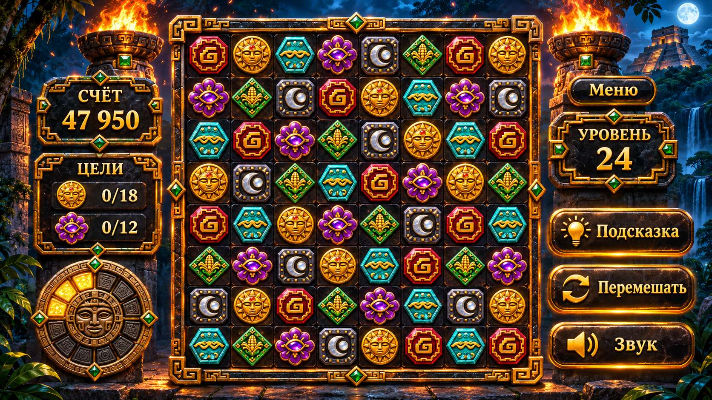

# «Хранитель Солнца» — сюжетная кампания, новые механики и атмосфера

Дата: 2026-11-06. Источник: заметка пользователя «Три в ряд» (атмосфера, сюжет и механики, новое название) и обсуждение в чате.

Пометка **[решение автора]** — то, что решено при написании документа без прямого согласия пользователя; остальное пользователь подтвердил.

## 1. Зачем и для кого

Игру «Сокровища Солнца» пользователь делает для своего отца-пенсионера. Отец играет **по 3–4 часа в день**, ему нравились «Сокровища Монтесумы». Сейчас в игре 4 уровня — это на один вечер. Нужна длинная игра с сюжетом, ради которой хочется возвращаться, и картинка уровня «премиальной» игры: атмосферная, солидная, без «дешёвой» графики.

Ориентир по ощущению — классические ацтекские match-3 вроде «Сокровищ Монтесумы». **Не копия:** свои сюжет, персонажи, названия, механики и арт.

**Что считается успехом:** отец неделями играет в кампанию, а потом возвращается, чтобы пройти уровни на большей сложности; игра выглядит так, что её не стыдно показать рядом с коммерческими.

## 2. Цели, не-цели, анти-цели

**Цели**
- Сюжетная кампания: 10 земель × 20 уровней = **200 уровней**, каждый уровень даёт осколок, осколки складываются в мозаики-легенды. Уровень на «Спокойно» — в среднем 4–6 минут, первое прохождение ~15–20 часов (при 3–4 часах в день — около недели); перепрохождение на «Обычно» и «Испытании», звёзды и сокровищница растягивают игру до 30+ часов. Основная сложность для баланса — «Спокойно»: отец, скорее всего, играет в нём **[решение автора]**.
- Новые механики-препятствия, по одной на землю.
- Три сложности и награда за перепрохождение.
- Новый стиль интерфейса («Обсидиан и огонь»), живые факелы, свет и искры, живые фоны, плавные переходы, сильные эффекты уничтожения и спецкамней.
- Переименование в «Хранитель Солнца».

**Не-цели**
- Не менять поле и обычные камни — пользователь считает их хорошими.
- Никаких аккаунтов, онлайна, рекламы, покупок.
- Не копировать «Сокровища Монтесумы» (имена, персонажей, арт, конкретные механики вроде их тотемов-бонусов).

**Анти-цели (провал, даже если «работает»)**
- Детский/мультяшный вид (как нынешний тотем и шаман), «дешёвое» 3D, пластмассовый UI в стиле веб-кнопок.
- Мелкий текст, иконки без подписей, суета, резкие вспышки и мигание.
- Потеря сохранения отца при обновлении.
- Тормоза на его компьютере из-за эффектов.
- Однообразные уровни, которые к сотому начинают повторяться.

## 3. Ограничения

- **Игрок — пожилой человек** (см. память проекта): крупные шрифты и цели нажатия, высокий контраст, подписи у кнопок, минимум мелочи, давление временем только по выбору.
- **Где играет отец:** скорее всего **Windows + Firefox**, игра открывается **по ссылке в интернете** (статический хостинг, например Vercel). Это главная целевая платформа: баланс производительности и форматов анимаций считаем под неё. Железо неизвестно — закладываемся на обычный ноутбук со встроенной графикой.
- **Стек как сейчас:** чистые HTML/CSS/JS, без сборки и библиотек. Игра должна работать и со статического хостинга, и локально двойным кликом по `index.html` (`file://`, для разработки) — поэтому данные уровней в JS-файлах (не JSON через fetch), все ассеты — локальные файлы проекта. Шрифты (сейчас Cinzel и Marcellus с Google Fonts) положить в проект **[решение автора]**.
- **Тексты интерфейса — HTML поверх текстур.** В картинки, нарисованные Codex, надписи не впекаются.
- **Браузеры:** в первую очередь **Firefox на Windows**, затем Chrome и Safari (десктоп и телефон). Все анимированные слои с прозрачностью (огонь, водопад и т.п.) проверяются как минимум в Firefox и Chrome, и в Safari.
- **Телефон — дополнительно:** у игры уже есть портретная раскладка; новый стиль должен на ней работать, но главный экран — десктоп.
- **Графика:** Codex (навык `codex-imagegen`) для рисованного арта, Blender — для симуляций огня и всего, где нужна объёмность. Подписки пользователя; платных API не использовать.
- `prefers-reduced-motion` уважать (уже есть в `styles.css`).

## 4. Сюжет и цель игрока

- **Завязка.** Повелитель Ночи украл Солнце, а Солнечный Камень разбился на осколки. Мир погрузился в ночь. Игрок — хранитель: безымянный, без лица, чтобы отцу было легко поставить себя на его место. Он идёт через десять земель и собирает Камень.
- **Осколки.** Каждый пройденный уровень даёт один осколок. После победы осколок перелетает на мозаику главы, картина дополняется. 20 осколков главы = одна мозаика-легенда этой земли (картину рисует Codex, она режется на 20 частей).
- **Рассказчик — старый жрец** (портретная иллюстрация, серьёзная, не мультяшная). Перед главой и после неё — 2–3 короткие фразы крупным шрифтом на иллюстрации, большая кнопка «Дальше», сюжет можно пропустить. Плюс пролог и эпилог.
- **Финал.** Десять мозаик складываются в Солнечный Камень, наступает рассвет.
- **Свет как прогресс.** Земли 1–3 — глубокая ночь, дальше небо понемногу светлеет; последняя земля — рассвет. Финальная сцена — Солнце над храмом.
- Имена Повелителя Ночи, жреца и мест — свои, придуманные; реальные имена богов не использовать **[решение автора]**. Тексты сцен пишет исполнитель.

## 5. Земли и механики (канонический список)

Каждая земля вводит одну новую механику (с коротким обучением на первом её уровне крупными подписями) и сохраняет все прошлые. Внутри главы сложность растёт плавно, пара уровней в главе — «передышки» попроще **[решение автора]**.

| # | Земля | Новая механика |
|---|-------|----------------|
| 1 | Джунгли Ягуара | Основы и уже существующие спецкамни: молния (4 в ряд), солнце (5 в ряд), бомба (квадрат 2×2), тотем (уголок/T) |
| 2 | Храм Змея | **Камни в лианах:** такой камень нельзя двигать; первый ряд с его участием срывает лиану, после этого он обычный |
| 3 | Лунные пещеры | **Золотые плиты под камнями:** цель — очистить все плиты, собирая ряды над ними |
| 4 | Горная тропа | **Валуны:** не двигаются, трескаются от рядов рядом, крепкие держат 2–3 удара |
| 5 | Озёрный город | **Реликвии:** идол засчитывается, когда опустится на дно поля |
| 6 | Болота | **Мох:** если ход не задел мох, он разрастается на одну клетку |
| 7 | Вулкан | **Двойные плиты** (два слоя) |
| 8 | Подземный мир | **Порталы:** камни проваливаются в одном месте и выпадают в другом |
| 9 | Ветреные вершины | **Поле необычной формы:** дыры, острова |
| 10 | Небесный храм | Всё вместе; последний уровень — **битва с Повелителем Ночи**: каждые несколько ходов он затягивает камни тьмой, тьму нужно разбивать |

- Нынешние 4 уровня становятся началом главы 1 и получают новые названия: «Храм Пернатого Змея» и «Пещера Лунного Света» сейчас совпадают с землями 2 и 3.
- **Цели уровней** комбинируются: собрать N камней цвета, очистить плиты, опустить реликвии, разбить валуны, сорвать лианы, вычистить мох, победить Повелителя.
- **Дары хранителя** (инструменты на трудные уровни): молот (разбить один камень), ветер (перемешать поле), факел (сжечь ряд). Где они берутся — см. §6.
- На «Спокойно» мох растёт медленнее, а битва мягче.
- Уровни описываются данными (размер/форма поля, препятствия, цели, время по сложностям, пороги звёзд), а не кодом на каждый уровень. Движок должен позволять дописывать главы позже.

## 6. Сложность, звёзды, перепрохождение

- **Три сложности**, переключаются в любой момент (на карте/в настройках):
  - **Спокойно** — без таймера, проиграть нельзя (как нынешний режим «Спокойно»).
  - **Обычно** — щадящий таймер (наследник нынешнего режима «На время»).
  - **Испытание** — строгий таймер, цели больше, препятствий больше.
- Ограничения по ходам не вводятся — только время, как сейчас **[решение автора]**.
- **Осколок отражает сложность:** пройден на «Спокойно» — каменный, на «Обычно» — серебряный, на «Испытании» — золотой. Хранится лучший. Мозаику можно «вызолотить» перепрохождением.
- **Звёзды** 1–3 за счёт, отдельно для каждой сложности **[решение автора]**.
- **Звёзды не тратятся** **[решение автора]**. Сокровищница открывается по сумме заработанных звёзд: дополнительные (золотые) мозаики и украшения хранителя — коллекционные предметы с короткой строчкой легенды. Состав сокровищницы — на исполнителе.
- **Дары хранителя** получают заряды из отдельного источника, не из звёзд **[решение автора]**: например, заряд за каждую новую звезду или за прохождение главы. Конкретное правило и баланс — на исполнителе.
- **Бесконечный спокойный режим** открывается после кампании: поле без конца, без целей, для отдыха **[решение автора, пользователь не возражал]**.

## 7. Стиль и интерфейс

Утверждён вариант **B «Обсидиан и огонь»** (картинка-ориентир настроения, не макет пикселей):

Отклонённые варианты для справки: [A «Храмовый камень»](assets/a-stone.png), [C «Нефрит и золото»](assets/c-jade.png). Палитру и настроение C можно использовать для последних, «рассветных» земель.

- Панели — полированный чёрный обсидиан с гравированной золотой филигранью и небольшими нефритовыми вставками; кнопки — обсидиановые плиты с золотой кромкой. Золотое свечение — только у активной/нажатой кнопки, а не у всех сразу (успокоить концепт ради отца).
- Над верхними углами поля — две каменные жаровни с живым огнём. Фон — ночные джунгли с храмом, водопадом и луной, приглушённый и чуть размытый, чтобы не спорить с полем.
- **Раскладка десктопа (по концепту):** слева — «Счёт», «Цели» (иконки камней + счётчики), круг Солнечного Камня с осколками текущей главы; справа — «Меню», «Уровень», крупные кнопки с иконкой и подписью: «Подсказка», «Перемешать», «Звук». Таймер (на «Обычно»/«Испытании») и индикатор серии совпадений сохраняются — место для них выбирает исполнитель.
- **Телефон (портрет):** поле на всю ширину; над ним — компактная строка счёта, уровня и целей; под ним — кнопки с подписями, цели нажатия не меньше ~56 px; жаровни уменьшаются и уходят в верхние углы, фоновые анимации упрощаются. Детали раскладки — на исполнителе, с проверкой на реальных размерах экрана.
- **Шрифты:** крупнее нынешних, высокий контраст (золото/кремовый на тёмном).
- **Спецкамни перерисовываются через Codex** в той же манере, что и обычные камни (`art-src/gems-sheet.png`): тотем — суровая нефритовая маска с золотой инкрустацией, а не рожица; молния, солнце, бомба — в том же духе. Нынешние Blender-значки уходят в архив, как прошлые наборы.
- **Мультяшный шаман уходит с игрового экрана** **[решение автора]**. Что он делал и куда это переезжает:
  - прыжок на совпадение и ликование на спецкамнях (`js/visuals-shaman.js`, события `sun:match`, `sun:special`, `sun:blast`) — теперь на это реагируют факелы (см. §8);
  - «тревога» при нехватке времени (`body[data-urgency]`) — переходит на таймер и огонь: пламя становится беспокойнее, таймер пульсирует;
  - счётчик «N камней» рядом с ним (`relicValue`, `state.clearedTotal`) — убирается; его место занимает круг Солнечного Камня с прогрессом главы.
- **Новые экраны:** карта пути по землям (уровни, осколки, звёзды), экран мозаики главы, сюжетные сцены с жрецом, сокровищница, выбор сложности. Стартовый экран — в новом стиле, с названием «Хранитель Солнца». Нынешняя эмблема-медальон с улыбкой на стартовом экране заменяется на серьёзную.

## 8. Атмосфера и эффекты

**Огонь и свет**
- Пламя — реалистичная огненная симуляция из Blender, зацикленная анимация **[решение автора]**. Свет от огня и искры — в коде: тёплое мерцание по панелям и рамке поля, редкие поднимающиеся искры.
- **Огонь реагирует на игру:** обычный ряд — пламя чуть колышется; каскад или спецкамень — вспышка и сноп искр; чем больше каскад, тем сильнее. Нужен вариант анимации «вспышка» и плавный возврат к спокойному горению.
- Формат анимаций (спрайт-лист, анимированный WebP, видео с альфой и т.п.) выбирает исполнитель, но он обязан работать в Firefox на Windows (главное), Chrome и Safari, и с хостинга, и с `file://`. Учтите: видео с прозрачностью в Safari и в Firefox/Chrome требует разных кодеков — спрайт-листы/анимированный WebP этой проблемы не имеют.

**Живые фоны**
- Фон собран из слоёв, чтобы оживлять отдельные части. На первой земле: **текущий водопад** с лёгким туманом, **светящаяся «дышащая» луна** с проплывающими тонкими облаками, **светлячки**.
- У каждой земли свой живой элемент: рябь на воде в озёрном городе, дым и отблески лавы у вулкана, плывущие облака в небесном храме и т.п. Всё медленное и приглушённое.
- 10 фонов (по одному на землю, светлеющих к финалу).

**Переходы (motion design)**
- Плавные, около полсекунды, без рывков. Камни поля ссыпаются волной при старте уровня; окна выезжают каменными плитами; переходы между экранами — мягкие (затухание через тьму/огонь).
- После победы осколок перелетает на мозаику.

**Уничтожение и спецкамни**
- Обычный камень раскалывается на осколки с пылью и золотыми бликами — без общей вспышки.
- Свой удар у каждого спецкамня: молния — золотой луч по ряду и столбцу; солнце — расходящаяся волна лучей; бомба — обсидиановый взрыв с углями; тотем — нефритовая волна.

**Спокойствие**
- Без резких вспышек и мигания, без мелкой суеты. На «Спокойно» эффекты мягче. Должен быть способ упростить эффекты, если компьютер не тянет (автоматически и/или переключателем) **[решение автора]**.
- Звук: существующие музыка и эффекты остаются; тихий треск огня и шум водопада — по желанию исполнителя, приглушённо.

## 9. Название и сохранения

- Новое название — **«Хранитель Солнца»**: заголовок страницы, стартовый экран, README.
- **Сохранение отца переносится обязательно.** Сейчас ключ `localStorage` — `sun-treasures-save` (`js/game.js`, `SAVE_KEY`), в нём открытые уровни и лучший счёт. Новый формат сохранения (главы, осколки по сложностям, звёзды, заряды даров, сокровищница) читает старый ключ при первом запуске и переносит прогресс в главу 1; старый ключ не стирается сразу **[решение автора]**.
- `localStorage` привязан к адресу сайта. Поэтому каждое обновление выкладывается **по тому же адресу**, который у отца, — тогда перенос работает. Если адрес когда-нибудь придётся сменить, нужен экспорт/импорт сохранения (например, кнопка «Перенести прогресс» с кодом) — на случай смены адреса или браузера заложить его в фазе 1 **[решение автора]**.
- Выкладка на хостинг — после каждой фазы, с подтверждения пользователя.

## 10. Проверка качества

- **Каждый из 200 уровней проходим** на каждой сложности, а кривая сложности ровная — нужна автоматическая проверка ботом-симулятором (основа — `tools/economy-sim.js` и `js/economy.js`). Пороги звёзд и времена подбираются по ней.
- Визуальная проверка в Firefox (главное), Chrome и Safari, десктоп и телефон.
- Производительность: плавно в Firefox на обычном Windows-ноутбуке со встроенной графикой при всех эффектах; на слабом устройстве эффекты упрощаются сами.

- **Арт согласуется образцами.** Прежде чем рисовать серию (фоны, мозаики, сцены жреца, спецкамни, текстуры UI, огонь), исполнитель показывает пользователю 1–2 образца и получает «да»; дальше серия идёт в утверждённом стиле. Если у подписки Codex упрёмся в лимит — сначала арт фаз 1–2, слои фонов переиспользуются между землями **[решение автора]**.

## 11. Порядок работ

Это три подпроекта: движок кампании и механик, новый внешний вид и атмосфера, контент (уровни, фоны, мозаики, тексты). Порядок — так, чтобы отец рано получил заметное улучшение:

1. **Движок кампании + главы 1–2.** Модель данных уровней, карта, осколки и мозаика, сложности и звёзды, перенос сохранения, механика лиан, сюжетные сцены (можно с временным артом), переименование. 40 играбельных уровней.
2. **Новый внешний вид и атмосфера.** Стиль B, перерисованные спецкамни, огонь со светом и реакцией, живой фон первых земель, переходы, новые эффекты уничтожения, телефонная раскладка.
3. **Главы 3–10.** По одной механике на главу, фоны, мозаики, тексты; бот-проверка каждой главы.
4. **Финал и дополнительное.** Битва с Повелителем Ночи, эпилог и рассвет, сокровищница, дары хранителя (если не вошли раньше), бесконечный режим.

## 12. Оставлено исполнителю

- Конкретные имена и тексты сцен, названия уровней.
- Точные числа баланса: времена, цели, пороги звёзд, частота роста мха, сила валунов, ритм босса.
- Формат анимаций и техника света/частиц (в рамках ограничений §3).
- Точное расположение таймера и индикатора серии, детали телефонной раскладки.
- Состав сокровищницы и правило зарядов даров.
- Новые звуки (если нужны).
